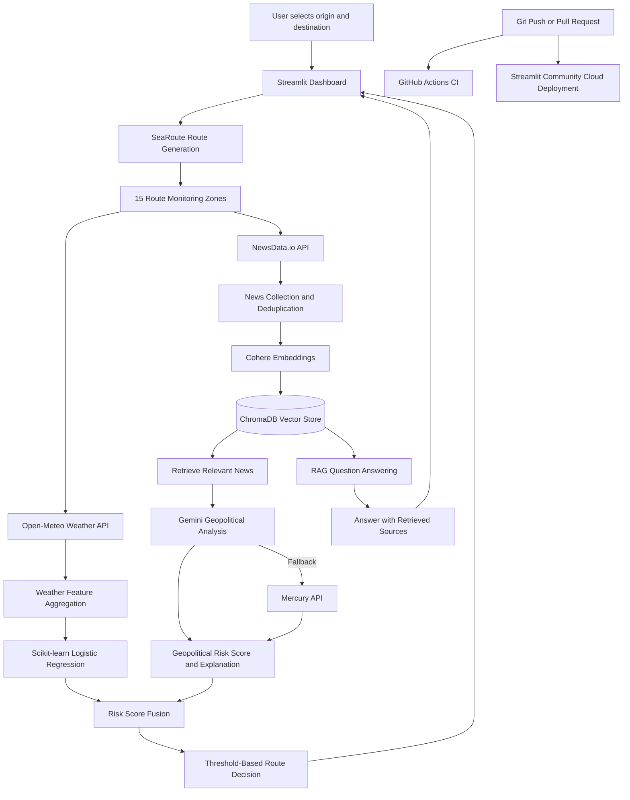

# RouteGuard AI

**Maritime Route Risk Intelligence | Machine Learning | RAG | CI/CD**

RouteGuard AI is an experimental maritime route risk intelligence platform that combines machine learning, live weather forecasts, geopolitical news analysis, and retrieval-augmented generation (RAG) to support maritime route assessment.

The application allows users to select ports, analyze a maritime route, visualize route conditions, review geopolitical risk assessments, and explore retrieved news evidence through an interactive Streamlit dashboard.

**Live on:** https://routeguard-maritime-logistics-risk.streamlit.app

**GitHub Repository:** https://github.com/Harin22/routeguard-ai


## Features

- **Maritime Route Planning:** Select from 25 configured ports with country information, UN/LOCODE, and geographical coordinates.
- **Route Generation:** Generate maritime route geometry, estimate distance and duration, and produce alternative route candidates.
- **Live Weather Analysis:** Retrieve weather forecasts from Open-Meteo across 15 monitoring zones along the selected route.
- **Geopolitical News Ingestion:** Collect route-specific news articles from NewsData.io.
- **Machine Learning:** Use a scikit-learn Logistic Regression pipeline to estimate hazard probability from weather and historical geopolitical features.
- **LLM-Based Risk Assessment:** Analyze retrieved geopolitical evidence using Google Gemini, with Mercury as a fallback provider.
- **Retrieval-Augmented Generation:** Generate Cohere embeddings, store news in ChromaDB, and retrieve relevant articles for evidence-based analysis and question answering.
- **Interactive Dashboard:** Visualize route geometry, risk metrics, weather measurements, news ingestion results, geopolitical explanations, and available alternatives.
- **Application Logging:** Record route-analysis starts, completion times, risk scores, and failures.
- **CI/CD:** Run automated checks through GitHub Actions and automatically deploy the dashboard using Streamlit Community Cloud.

## System Architecture




## RouteGuard AI architecture diagram


## How It Works

### 1. Route Planning

Users select an origin and destination from the configured port list. SeaRoute generates the primary maritime route, calculates its distance and estimated duration, and generates alternative route candidates.

The route is divided into monitoring zones for weather retrieval and geopolitical news analysis.

### 2. Weather Data and Machine Learning

The project includes historical weather collection and feature preparation pipelines built around Open-Meteo data.

The live prediction pipeline aggregates the first 24 forecast hours at each monitoring zone and uses nine weather features:

- `temperature_2m`
- `precipitation`
- `rain`
- `pressure_msl`
- `cloud_cover`
- `wind_speed_10m`
- `wind_gusts_10m`
- `wind_direction_10m`
- `weather_code`

A saved scikit-learn Logistic Regression pipeline generates a hazard probability, which is converted to a 0–10 ML risk score.

### 3. Historical Geopolitical Data

The training-data pipeline processes historical GDELT event archives to derive daily geopolitical indicators, including:

- `geo_security_events`
- `geo_hostile_events`
- `geo_avg_tone`

These indicators are merged with historical weather data to create a training dataset. The target is a proxy for hazard activity over the following seven calendar days, derived from severe-weather thresholds and high GDELT event activity.

The target is not a verified record of actual maritime disruptions.

### 4. Live News Ingestion

For a selected route, RouteGuard collects fresh news articles from NewsData.io across route monitoring zones.

Articles are deduplicated, associated with a route key, embedded using Cohere, and stored in ChromaDB.

This supports route-scoped retrieval and provides news evidence for the geopolitical analysis pipeline.

### 5. Geopolitical Analysis

RouteGuard retrieves relevant news evidence from ChromaDB and sends it to an LLM for geopolitical risk assessment.

The analysis produces a risk score from 0 to 10 and a textual explanation based on the retrieved evidence. Google Gemini is attempted first, with Mercury used as a fallback.

The resulting assessment is displayed alongside the ML score, weather information, and retrieved evidence.

### 6. Risk Fusion and Route Selection

The current implementation combines the ML risk score and geopolitical risk score using an equal-weight average:

```python
final_score = (ml_score + geopolitical_score) / 2
```

The default risk threshold is 6.0 out of 10. If the combined score reaches the threshold, the route-selection logic generates distinct alternative candidates. Otherwise, it recommends the primary route under the current model policy.

**Important limitation:** The alternatives are currently deduplicated and sorted by distance; they are not independently risk-scored. A shorter route should not automatically be considered safer.

### 7. Retrieval-Augmented Generation

The RAG component uses Cohere embeddings and ChromaDB to retrieve relevant news documents in response to user questions.

The retrieved context is passed to the chat service to generate an answer with source metadata where available. External API rate limits and provider failures can affect reliability.

## Technology Stack

| Category | Technologies |
|---|---|
| Programming | Python |
| Data Processing | pandas, NumPy |
| Machine Learning | scikit-learn, Logistic Regression, joblib |
| Maritime Routing | SeaRoute |
| Weather Data | Open-Meteo API |
| News Ingestion | NewsData.io API |
| Historical Geopolitical Data | GDELT Events |
| LLM APIs | Google Gemini, Mercury (InceptionLabs) |
| Embeddings | Cohere |
| RAG and Vector Database | ChromaDB, LangChain Chroma integration |
| Dashboard | Streamlit |
| Visualization | PyDeck |
| Configuration | python-dotenv, Streamlit Secrets |
| CI | GitHub Actions |
| CD | Streamlit Community Cloud |
| Data Versioning | DVC metadata for selected datasets |

## Project Structure

```text
routeguard-ai/
├── app.py
├── requirements.txt
├── models/
│   └── logistic_regression.joblib
├── data/
│   ├── historical_weather_daily.csv.dvc
│   ├── processed/
│   │   ├── geopolitical_daily.csv.dvc
│   │   └── training_dataset.csv.dvc
│   └── raw/
├── src/
│   ├── data/
│   │   ├── build_training_dataset.py
│   │   ├── gdelt_geo.py
│   │   ├── historical_weather.py
│   │   ├── ports.py
│   │   ├── risk_zone.py
│   │   ├── route_sampler.py
│   │   ├── route_selection.py
│   │   └── zone_weather.py
│   ├── features/
│   ├── models/
│   │   └── train_baseline.py
│   └── rag/
│       ├── chat_service.py
│       ├── geopolitical_analyzer.py
│       ├── ingest_news.py
│       └── vector_store.py
└── .github/
    └── workflows/
        └── ci.yml
```

## Run Locally

### Prerequisites

- Python 3.12
- Git
- API credentials for NewsData.io, Google Gemini, Mercury, and Cohere

### Installation

Clone the repository:

```bash
git clone https://github.com/Harin22/routeguard-ai.git
cd routeguard-ai
```

Create and activate a virtual environment on Windows PowerShell:

```powershell
py -3.12 -m venv .venv
.\.venv\Scripts\Activate.ps1
```

Install the dependencies:

```powershell
python -m pip install --upgrade pip
python -m pip install -r requirements.txt
```

### Configure Environment Variables

Create a `.env` file in the project root:

```dotenv
NEWSDATA_API_KEY=your_newsdata_key
GEMINI_API_KEY=your_gemini_key
MERCURY_API_KEY=your_mercury_key
COHERE_API_KEY=your_cohere_key
```

Replace the placeholders with your own API keys. Never commit `.env` or expose credentials in source code.

### Launch the Dashboard

```powershell
streamlit run app.py
```

The dashboard will open locally in your browser.

### Streamlit Community Cloud Secrets

For cloud deployment, configure the following secrets in the app settings:

```toml
NEWSDATA_API_KEY = "your_newsdata_key"
GEMINI_API_KEY = "your_gemini_key"
MERCURY_API_KEY = "your_mercury_key"
COHERE_API_KEY = "your_cohere_key"
```

Do not commit these values to GitHub.

## Model Training Pipeline

The repository contains scripts for historical data preparation and baseline model training.

The intended combined data pipeline is:

```powershell
python src/data/historical_weather.py
python src/data/gdelt_geo.py
python src/data/build_training_dataset.py
python src/models/train_baseline.py
```

These commands depend on access to the required source datasets and successful data collection. Review the scripts before retraining, because the repository also contains prototype data-preparation scripts that use different label definitions.

The current training label is a proxy label, not ground-truth maritime incident data.

## CI/CD Pipeline

### Continuous Integration — GitHub Actions

The workflow is defined in:

`.github/workflows/ci.yml`

It runs automatically on pushes to `main` and pull requests targeting `main`.

The workflow:

1. Checks out the repository.
2. Sets up Python 3.12.
3. Installs the dependencies from `requirements.txt`.
4. Checks Python syntax in `src`.
5. Runs smoke checks for route generation, alternative-route generation, and loading the saved model with `predict_proba`.

The configured CI workflow has passed during project verification.

These are basic automated checks, not a comprehensive unit or integration test suite.

### Continuous Deployment — Streamlit Community Cloud

The GitHub repository is connected to Streamlit Community Cloud.

When changes are pushed to the connected `main` branch, Streamlit Community Cloud pulls the latest code, installs dependencies, and launches the updated dashboard.

The live deployment was verified during project development. CD is managed by Streamlit Community Cloud; the GitHub Actions workflow does not contain a separate deployment job.

## Application Logging

RouteGuard includes basic Python logging for:

- Route-analysis start events
- Successful analysis completion
- Analysis duration
- Final combined risk score
- Failed route-analysis attempts and exception tracebacks

This provides basic application-level observability through application process logs.

**Not currently implemented:** dedicated ML drift monitoring, Evidently AI reports, a Prometheus metrics endpoint, Grafana dashboards, or production alerting.

## Known Limitations

RouteGuard is an experimental portfolio project. Several limitations must be considered when interpreting its output.

1. **Geopolitical features during live inference:** The saved ML model was trained with nine weather features and three GDELT-derived geopolitical features. During live prediction, the three geopolitical model inputs are currently set to missing values and imputed by the training pipeline. Fresh news is analyzed separately through the LLM pipeline and is not currently transformed into the same three ML features.

2. **Proxy labels:** The model target is derived from historical weather thresholds and GDELT high-activity events. It is not a validated probability of an actual maritime incident or route disruption.

3. **Risk fusion:** The equal-weight average can dilute a high geopolitical score when the ML score is low. The fusion rule and threshold require further validation.

4. **Alternative routes:** Alternative candidates are sorted by distance and are not independently assessed for their own weather and geopolitical risks.

5. **External API reliability:** News ingestion, embeddings, and LLM analysis depend on external providers. Rate limits, outages, or invalid credentials can interrupt analysis.

6. **Model monitoring:** Dedicated data-drift monitoring, prediction-drift reports, and production alerting have not yet been implemented.

7. **Data reproducibility:** Selected datasets have DVC pointer files. Reproducing training requires the source datasets and any required DVC storage to be available. Local ChromaDB data is excluded from Git.

RouteGuard should be treated as decision support for experimentation and demonstration, not as an operational maritime-safety system.

## Future Improvements

- Align the ML training features with live inference inputs, potentially by training a weather-only model and keeping geopolitical analysis as a separate branch.
- Validate the risk-fusion policy so a high geopolitical warning cannot be hidden by an average.
- Independently assess candidate alternatives before ranking routes by risk.
- Expand test coverage for feature preparation, model predictions, risk fusion, ingestion failures, and route selection.
- Add Evidently AI for data drift and prediction monitoring.
- Consider Prometheus and Grafana for operational metrics and dashboards when a suitable metrics endpoint and hosting environment are available.
- Improve RAG rate-limit handling, retries, and fallback behavior.
- Add more systematic model evaluation using appropriately validated historical outcomes.

## Project Status

- Streamlit dashboard deployed and accessible.
- Maritime route generation and mapping implemented.
- Live weather and route-specific news ingestion implemented.
- Historical ML training pipeline and saved baseline model included.
- LLM-based geopolitical analysis implemented.
- ChromaDB-backed news retrieval and RAG chat interface included.
- GitHub Actions CI configured and passing the current smoke checks.
- Streamlit Community Cloud automatic deployment verified.
- Basic application logging implemented.
- Dedicated ML monitoring and independently risk-scored alternative routes remain future improvements.

---

**RouteGuard AI — an production level engineering portfolio project exploring maritime route intelligence through machine learning, live data integration, retrieval-augmented generation, and automated deployment.**
